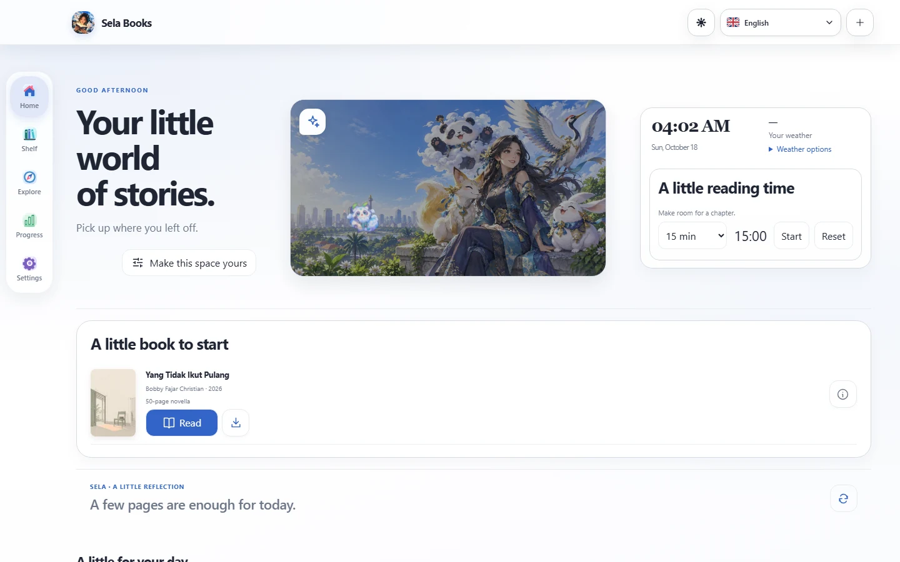
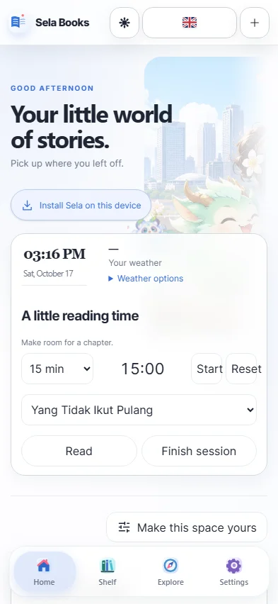
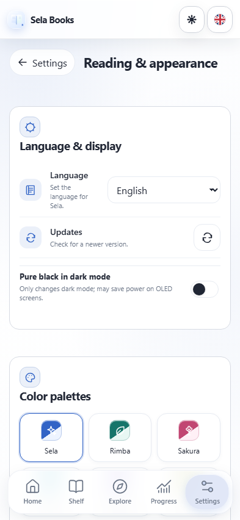

<p align="center"></p>
<h1 align="center">Sela Books</h1>
<p align="center"><strong>Your personal bookshelf.</strong><br>Stories, documents, scriptures and a little room to yourself.</p>

<p align="center">
  <a href="https://github.com/bobbyfch/sela/actions/workflows/ci.yml"></a>
  
  
  
</p>

<p align="center">
  <a href="https://bobbyfch.github.io/sela/app/">Open the app</a> ·
  <a href="https://bobbyfch.github.io/sela/">Project site</a> ·
  <a href="docs/README.md">Documentation</a> ·
  <a href="README.id.md">Bahasa Indonesia</a> ·
  <a href="https://github.com/bobbyfch/sela/releases">Releases</a>
</p>

<p align="center"></p>

Sela is a private reading space for books, comics, documents and scriptures. The name means a pause: a small place in the day to return to a story. The library lives in your browser, works offline once installed, and nothing is uploaded.

Sela ships in two forms that share one document engine:

| | Sela Books | Sela Viewer |
| --- | --- | --- |
| What it is | Installable web app (PWA) with a personal shelf | Framework-independent reader you embed in any site |
| Storage | IndexedDB on your device | None, it opens the document you give it |
| Use it from | [bobbyfch.github.io/sela/app](https://bobbyfch.github.io/sela/app/) | CDN script or ESM import, see [Install](docs/install.md) |

## Contents

- [Features](#features)
- [Quick start](#quick-start)
- [Embed the Viewer](#embed-the-viewer)
- [Faith readings and content licences](#faith-readings-and-content-licences)
- [Privacy](#privacy)
- [Documentation](#documentation)
- [Contributing](#contributing)
- [Security](#security)
- [License](#license)

## Features

### Reading

- PDF, EPUB, CBZ, TXT, Markdown, HTML, FB2, DOCX and ODT. DjVu works with an external decoder you supply.
- Book, single-page, manga (right to left) and continuous webtoon modes.
- Bookmarks, notes, highlights, reading progress, collections, backup and restore, all local-first.

### Shelf and Faith tab

- Search your shelf with an on-device index that understands common Indonesian phrasing. The query is not uploaded.
- When you choose a faith or tradition in Settings, a **Faith** tab appears on the shelf with the scriptures and classics of that tradition. See [Faith readings](#faith-readings-and-content-licences).

### Discover

- Pick a catalogue, then a collection, then an optional topic. Sources include Project Gutenberg, Wikisource, GITenberg, Open Library, OpenStax, BookRank rankings, curated Sela picks and your own OPDS catalogues. Records without an open edition link out instead of pretending they can be downloaded. See [library sources](docs/library-sources.md).

### Home

- Quotes, topic headlines, an on-this-day feed, a reading calendar, optional weather, a focus timer and habit widgets. Estimated prayer times are requested only when you ask.

### Progress

- Reading time and streaks, with weekly, monthly and yearly views. Sessions pause when the reader is not visible.

### Look and language

- Eight palettes (Sela, Rimba, Sakura, Samudra, Lembayung, Kenanga, Senja, Arunika) with separate light, dark and OLED appearance.
- Interface languages: English, Indonesian, Japanese, Spanish, French, German, Portuguese, Chinese and Korean.

<p align="center"> </p>

## Quick start

Use the hosted app, or run it locally.

```sh
git clone https://github.com/bobbyfch/sela.git
cd sela
npm ci
npm run build
npm run serve
```

Then open `http://127.0.0.1:4173/sela/app/` for the app and `http://127.0.0.1:4173/sela/` for the project site. The local server mirrors the `/sela/` prefix of GitHub Pages, so asset paths behave as they do in production.

Requirements: Node.js 22.18 or newer (24 recommended) and npm.

| Command | Purpose |
| --- | --- |
| `npm run typecheck` | Type-check every project |
| `npm test` | Unit tests |
| `npm run test:browser` | Playwright suite in Chromium, Firefox and WebKit, plus a real service-worker project |
| `npm run build` | Rebuild generated assets, manifests and cache identities |
| `node --experimental-strip-types scripts/packs.ts --check` | Verify the reading-pack catalogue |

More in [Development](docs/development.md).

## Embed the Viewer

```html
<script src="https://cdn.jsdelivr.net/gh/bobbyfch/sela@v0.9.0-beta.8/dist/js/sela.min.js"></script>
<button id="read" type="button">Read PDF</button>
<script>
  const reader = new Sela({ pdfUrl: '/books/story.pdf', title: 'My story', mode: 'book', theme: 'auto', language: 'en' });
  document.querySelector('#read').addEventListener('click', () => reader.open());
</script>
```

Pin a release tag in production. ESM, TypeScript, React, Vue, Svelte, Astro, PHP and static-HTML examples are in [Install](docs/install.md) and [Integrations](docs/integrations.md).

## Faith readings and content licences

Choose a faith or tradition under **Settings → Library tools**. The Faith tab then lists readings for that tradition only. Nothing is downloaded until you press a button, and nothing is added to your books.

| Tradition | Readings |
| --- | --- |
| Islam | Quran (Arabic with Indonesian or English translation) and hadith downloaded from their publishers, plus the stories of the 25 prophets, Syair Perahu and Gurindam Dua Belas |
| Protestant Christianity | Alkitab TSI (Indonesian), World English Bible, Christian classics |
| Catholic Christianity | Douay-Rheims, the deuterocanonical books, Christian classics |
| Buddhism | The Pali discourses in English (DN, MN, SN, AN and the shorter collections), Samyukta Agama in Indonesian, Dhammapada, Jataka tales, The Gospel of Buddha |
| Hinduism | Bhagavad-Gita, Upanishads, Yoga Sutras, Ramayana |
| Confucianism | Analects, Mencius, The Great Learning, The Doctrine of the Mean, Tao Teh King |

Downloads are checked before they are saved, work offline, and can be removed in Settings without touching your books, notes or backups. Saved entries, your own notes and quotes, and your reading position are part of Sela backups.

Each edition keeps its own licence. The SELA MIT licence covers code and SELA-written text only. See [Faith readings: sources](docs/faith-readings-sources.md) and [third-party notices](THIRD_PARTY_NOTICES.md). The 25 prophet stories are a draft that a scholar has not reviewed yet, and the app says so.

## Privacy

Books, notes and progress stay in IndexedDB on your device. There is no analytics and no document upload. The app contacts a third party only for a feature you turn on or a source you choose: Discover catalogues, optional weather and prayer estimates, and publisher downloads for the Quran and hadith. Details are in [Security](docs/security.md).

## Documentation

Start at the [documentation index](docs/README.md). Useful entry points: [Install](docs/install.md), [Install as an app](docs/pwa.md), [Formats and limits](docs/formats.md), [Backup](docs/backup.md), [Library sources](docs/library-sources.md), [Repository map](docs/repository-map.md).

## Contributing

Bug reports and small, reproducible improvements are welcome. Read [CONTRIBUTING.md](CONTRIBUTING.md) first, and the [code of conduct](CODE_OF_CONDUCT.md).

## Security

Report vulnerabilities privately. See [SECURITY.md](SECURITY.md).

## License

Sela is released under the [MIT License](LICENSE). Third-party components and content have their own licences, listed in [THIRD_PARTY_NOTICES.md](THIRD_PARTY_NOTICES.md). The optional external DjVu decoder is not part of Sela and is licensed separately.

Sela (pronounced *seh-lah*) means a pause. Its illustrations feature an original mage character and small bookish creatures.

© Bobby Fajar Christian.
